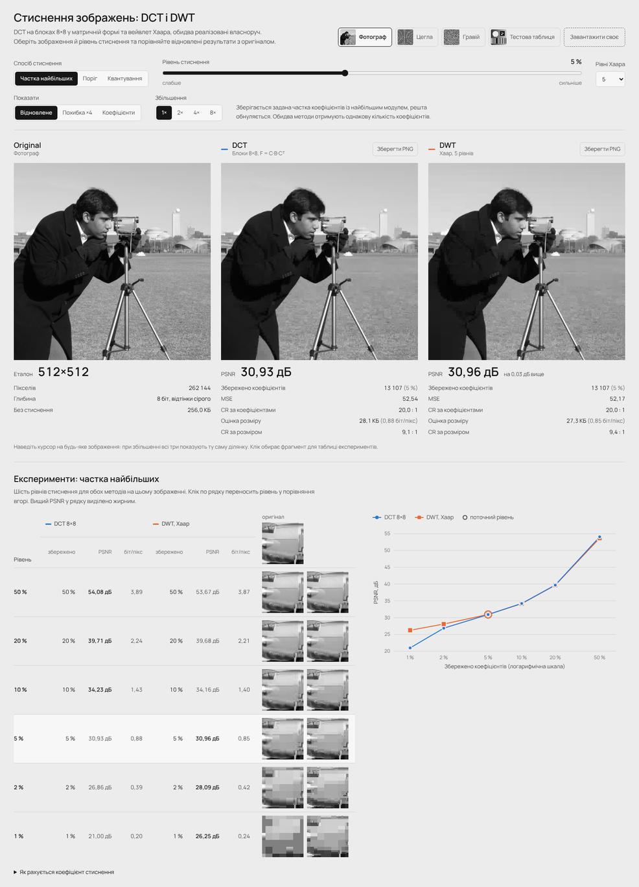
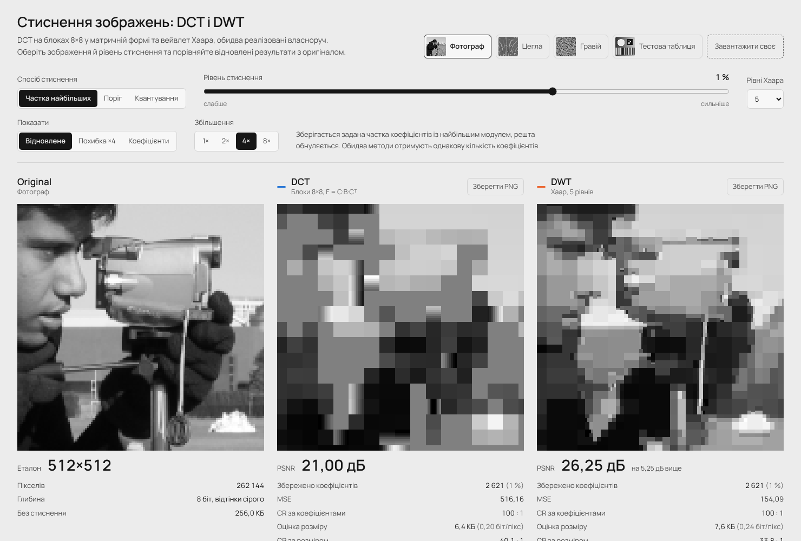

# Стиснення зображень: DCT і DWT — лабораторна робота №3

Вебзастосунок для експериментального стиснення зображень у відтінках сірого двома методами:
**DCT** на блоках 8×8 у матричній формі та **DWT** з вейвлетом Хаара. Результати показуються поруч
(Original | DCT | DWT) з PSNR, кількістю збережених коефіцієнтів і коефіцієнтом стиснення.

Стек: React + TypeScript + Vite, стилі Tailwind CSS. Перетворення реалізовані власноруч на `Float64Array`,
без жодних бібліотек обробки сигналів.



## Запуск

Потрібен Node.js ≥ 22.

```bash
npm install
npm run dev      # http://localhost:5173
npm test         # юніт-тести перетворень
npm run build    # production-збірка в dist/
```

## Відповідність вимогам

| Вимога | Де реалізовано |
|---|---|
| Вхідне зображення у відтінках сірого, 512×512 | 4 вбудовані зображення + завантаження свого. Колір → яскравість за BT.601, центральний квадрат, масштаб до 512×512 (`src/lib/images.ts`) |
| DCT на блоках 8×8 через матричне подання | `F = C · B · Cᵀ`, `B = Cᵀ · F · C` (`src/core/dct.ts`) |
| Пряме перетворення Хаара, обернене, багаторівневе | `src/core/haar.ts`, від 1 до 9 рівнів, за замовчуванням 5 |
| Обробка / відкидання коефіцієнтів | Три способи на вибір: частка найбільших, поріг, квантування (`src/core/compression.ts`) |
| Зміна рівня стиснення і спостереження впливу | Слайдер, перерахунок наживо |
| ≥ 3 рівні для кожного методу | Таблиця експериментів: 6 рівнів для обраного способу, обидва методи, фрагменти зображень і графік PSNR |
| Кількість або частка збережених коефіцієнтів | Під кожним зображенням і в таблиці |
| PSNR | `src/core/metrics.ts`, рахується на 8-бітному результаті |
| Візуальна якість | Синхронне збільшення 2–8× в усіх трьох панелях, карта похибки ×4, фрагменти в таблиці |
| Коефіцієнт стиснення із зазначенням способу | Два способи, див. нижче |
| Візуальне порівняння Original \| DCT \| DWT | Три панелі поруч |

## Алгоритми

### Зсув рівня

Перед обома перетвореннями від пікселів віднімається 128, як у JPEG. Тоді коефіцієнти симетричні відносно
нуля, і обидва методи працюють з однаковими даними.

### DCT

Матриця DCT-II розміру N×N (N = 8):

```
C[k][n] = α(k) · cos(π(2n + 1)k / 2N),   α(0) = √(1/N),   α(k) = √(2/N), k > 0
```

`C` ортонормована (`C · Cᵀ = I`), тому обернене перетворення — це просто транспонування.
Зображення ділиться на 4096 блоків 8×8, кожен перетворюється як `F = C · B · Cᵀ`.

### Хаар

Один крок для пари сусідніх значень `(a, b)`: апроксимація `s = (a + b) / √2`, деталь `d = (a − b) / √2`.
Рівень 2D: спершу всі рядки, потім усі стовпці. Наступний рівень застосовується до підсмуги LL.
Виходить розкладка Маллата (її видно в режимі «Коефіцієнти»).

Множник `1/√2` робить перетворення ортонормованим, як і DCT. Це важливо для порівняння:

- **рівність Парсеваля**: похибка відновлення точно дорівнює енергії відкинутих коефіцієнтів,
  `Σ(x − x̂)² = Σ(c − ĉ)²`;
- коефіцієнти обох методів мають однаковий масштаб, тому один поріг T чи крок Δ означає одне й те саме.

### Способи стиснення

| Спосіб | Що робить | Параметр |
|---|---|---|
| Частка найбільших | Зберігає рівно `round(p · N)` коефіцієнтів із найбільшим модулем, решту обнуляє. Через Парсеваля це оптимально за MSE для заданої кількості коефіцієнтів | p, 0,1 %…100 % |
| Поріг | Обнуляє всі `\|c\| < T` | T |
| Квантування | `ĉ = Δ · round(c / Δ)`, коефіцієнти з `\|c\| < Δ/2` стають нулями | Δ |

Відбір у «частці найбільших» глобальний, по всьому зображенню. Так обидва методи отримують однаковий
бюджет коефіцієнтів, і порівняння PSNR чесне.

### PSNR

`PSNR = 10 · log₁₀(255² / MSE)`. MSE рахується між оригіналом і відновленим зображенням після обрізання
до 0…255 та округлення, тобто на тому, що реально показується і зберігається у PNG. Якщо зображення
збігаються точно, PSNR = ∞.

### Коефіцієнт стиснення

Кількість ненульових коефіцієнтів і розмір файлу — не одне й те саме, тому програма показує обидва:

1. **CR за коефіцієнтами** = N / кількість ненульових коефіцієнтів. Це верхня оцінка: вона не враховує,
   що потрібно зберегти ще й позиції коефіцієнтів, а значення займають різну кількість біт.
2. **CR за розміром**. Цілі коефіцієнти (для квантування це індекси `round(c / Δ)`, для інших способів —
   збережені коефіцієнти, округлені до цілих) обходяться від низьких частот до високих: у DCT зигзагом
   у кожному блоці, у Хаара від LL до найдрібніших деталей. Потім вони записуються як zigzag-varint і
   стискаються DEFLATE. Оригінал вважається нестисненим: 1 байт на піксель (8 біт/пікс).
   Модель груба, до JPEG і JPEG 2000 їй далеко, але вона чесно враховує і позиції, і значення.

## Перевірка правильності

`npm test` запускає 21 юніт-тест (`tests/core.test.ts`), серед них:

- `C · Cᵀ = I`;
- матричне `C·B·Cᵀ` збігається з формулою DCT-II у вигляді подвійної суми;
- точне відновлення без відкидання коефіцієнтів для DCT і для всіх рівнів Хаара;
- значення LL/HL/LH/HH на прикладі 2×2;
- рівність Парсеваля: похибка в пікселях = енергія відкинутих коефіцієнтів (з точністю до 10⁻⁹);
- «частка найбільших» зберігає рівно k коефіцієнтів навіть за однакових модулів.

Додатково, під час розробки результати звірено з еталонними реалізаціями (у сам проєкт вони не входять):
DCT збігається з `scipy.fft.dctn(norm='ortho')` до 2·10⁻¹², Хаар — з `pywt.wavedec2('haar', mode='periodization')`
до 10⁻¹¹, PSNR повного циклу — з реалізацією на NumPy.

## Результати на зображенні «Фотограф»

Спосіб «частка найбільших», Хаар 5 рівнів:

| Збережено | DCT PSNR | DWT PSNR | DCT біт/пікс | DWT біт/пікс |
|---|---|---|---|---|
| 50 % | 54,08 дБ | 53,67 дБ | 3,89 | 3,87 |
| 20 % | 39,71 дБ | 39,68 дБ | 2,24 | 2,21 |
| 10 % | 34,23 дБ | 34,16 дБ | 1,43 | 1,40 |
| 5 % | 30,93 дБ | 30,96 дБ | 0,88 | 0,85 |
| 2 % | 26,86 дБ | 28,09 дБ | 0,39 | 0,42 |
| 1 % | 21,00 дБ | 26,25 дБ | 0,20 | 0,24 |

Спостереження:

- **До 5 % методи майже рівні** (різниця < 0,5 дБ).
- **При сильному стисненні DCT різко програє.** 1 % — це 2 621 коефіцієнт, а блоків 8×8 у зображенні 4 096,
  тож DCT фізично не може зберегти навіть DC-коефіцієнт кожного блока: при 1 % без DC залишаються 1 604 блоки,
  і вони стають рівно сірими. Хаар із 5 рівнями зберігає грубу копію зображення в підсмузі LL розміром лише
  16×16 = 256 коефіцієнтів.
- **На регулярній текстурі («Цегла») краще DCT**: при 10 % — 43,3 дБ проти 39,4 дБ. Косинуси добре описують
  періодичні структури, а кусково-сталі функції Хаара — гірше.
- **Артефакти різні.** У DCT — блочність на межах 8×8 і «дзвін» (ефект Гіббса) біля різких меж. У Хаара —
  «сходинки»: квадрати розміром 2ˡ зі сталою яскравістю. Найкраще це видно на «Тестовій таблиці» при
  збільшенні 4–8×.



## Структура

```
src/
├── core/                 власна реалізація, без DOM і без бібліотек
│   ├── matrix.ts         множення та транспонування матриць
│   ├── dct.ts            матриця DCT, блочне пряме/обернене перетворення, зигзаг
│   ├── haar.ts           багаторівневий 2D Хаар, порядок підсмуг
│   ├── compression.ts    частка найбільших, поріг, квантування
│   ├── metrics.ts        MSE, PSNR
│   ├── encoding.ts       оцінка розміру: zigzag-varint + DEFLATE
│   └── pipeline.ts       повний цикл для одного методу
├── hooks/                useCompression (поточний рівень), useExperiments (таблиця)
├── components/           панелі, керування, таблиця, графік
└── lib/                  завантаження зображень, підписи способів, рендер на canvas
tests/core.test.ts        юніт-тести
```

## Тестові зображення

«Фотограф» (`camera`), «Цегла» (`brick`) і «Гравій» (`gravel`) взято з набору даних
[scikit-image](https://scikit-image.org/docs/stable/api/skimage.data.html). За документацією scikit-image,
усі три поширюються під ліцензією CC0. «Тестова таблиця» генерується програмно (`testPattern` у `src/lib/images.ts`).
